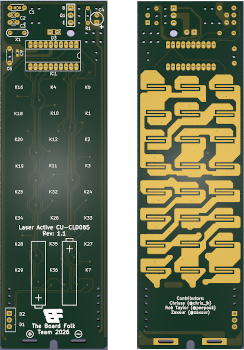

# LaserActive CU-CLD085 Remote Control

This repository contains a recreation of the remote control PCB
for the Laser Active. This recreation was reversed engineering using scanned images of the original
board's copper layers, so should be a reasonably accurate reproduction.

Both THT and SMD caps added, use one or the other.

[**Interactive BOM**][IBOM]

Use board thickness 1.0 mm

[**PCB Gerber**][GERBER]

## Thanks

  * Rob Taylor ([@PeepoUK](https://github.com/PeepoUK)) for doing most of
    the PCB layout
  * Zaxour 阿宅 (@zaxour) for tweaking and testing
  * The rest of the Board Folk Team for their support and general
    coolness.
&nbsp;

## Legal

As the product of this project is a replica of a proprietary product, the
the author makes no claim of copyright to the schematics nor PCB layouts and
releases these into the public domain, solely for the purposes of study and
historical preservation.

You are free to produce PCBs based on this project's designs at your own risk
and without limitation, for your own use or for sale and/or repair at a
reasonable price. Attribution is appreciated. The authors are not obliged to
provide support of any kind.

Under no circumstances will the authors be held responsible or liable in any
way for losses, damages or costs resulting from the use of the information
and/or resources of this project.

The resources are provided "as-is" without warranty of any kind, either
expressed or implied, including, but not limited to, the implied warranties
of merchantability and fitness for a particular purpose.

[IBOM]: http://htmlpreview.github.io/?https://raw.githubusercontent.com/Board-Folk/LaserActive-CU-CLD085-Remote/main/ibom.html

[GERBER]: https://github.com/Board-Folk/LaserActive-CU-CLD085-Remote/raw/refs/heads/main/jlcpcb/production_files/GERBER-LaserActive-CU-CLD085-Remote.zip
